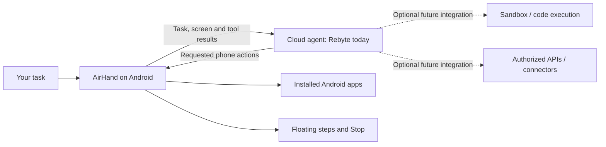

# AirHand

**A cloud agent that can use your Android phone.**

AirHand started in a fork of [droidrun/mobilerun](https://github.com/droidrun/mobilerun).
It takes the observe → act → observe approach and builds a native Android client
around a cloud-hosted agent. This repository contains that standalone Kotlin app.
Upstream attribution and the MIT license are retained.

Tell AirHand what you want to do. The cloud agent plans the steps, and the phone
opens apps, reads the screen, taps, swipes, and types. A floating control shows
what is happening and keeps **Stop** within reach.

[Download the APK](https://github.com/nomoat/airhand/releases/latest) ·
[Installation](#install-and-try-it) · [Privacy](PRIVACY.md) · [Testing](TESTING.md)

- **No root required.** No connected computer is needed after installation.
- **Visible actions.** A draggable floating control stays on screen during tasks.
- **Local run history.** Open **Run history** to revisit tasks and follow their
  Rebyte links to the cloud execution details. No separate AirHand server is needed.
- **Screen stays on during tasks.** The floating control keeps the screen bright
  while another app is open. Stop or finish the task to restore normal screen timeout.
- **Bring your own key.** The current backend is the Rebyte Agents API.
- **Open source.** Inspect and change the Android executor and cloud integration.
- **English interface.** Type your task and select **Start task**. Use the × button
  in the input field to clear it for a new task.

This is an early developer release. It has been tested with YouTube on an Android
emulator and a Pixel phone. Compatibility with every app or device is not implied.

## Why put the agent in the cloud?

A phone is a useful place to take action. A cloud runtime is a useful place to
plan, run code, and connect services. Keeping those roles separate lets the phone
remain a small execution client instead of hosting an entire agent runtime.

For example, a cloud agent could fetch data from an authorized API, analyze a CSV
in a sandbox, and then ask the phone to open an app and carry out the next step.
The phone would not need a Python environment or copies of every integration.

That architecture creates room for:

| Cloud capability | Why it helps |
| --- | --- |
| Sandboxed code execution | Parse files, transform data, or calculate results before acting on the phone. |
| APIs and connectors | Combine authorized business or personal data with an app that only exposes a mobile interface. |
| Central agent updates | Change prompts, models, or cloud tools without rebuilding the phone app when the tool protocol stays compatible. |
| Session history | Inspect cloud decisions and tool results alongside the phone's local execution journal. |
| Remote model inference | Keep model computation off the phone. Network traffic, screenshots, and an active screen still use battery. |

**Those are architectural opportunities, not a list of shipped integrations.**
The current app creates Rebyte sessions with `environment.type = "none"` and
registers only phone tools. It does not yet provision a sandbox or connect your
external accounts. Adding those capabilities requires cloud-side work and the
appropriate credentials and permissions.

A cloud session also does not make the phone an unattended server: it must be
online and unlocked, and Android must keep its accessibility service available.

## How it works



The cloud runs the agent loop and chooses actions. AirHand executes a fixed set
of tools through Android's `AccessibilityService` and returns observations.

| On the phone | In the cloud |
| --- | --- |
| Task input and encrypted API-key storage | Agent session and model inference |
| App discovery, screenshots, and UI text | Planning the next tool call |
| Taps, swipes, text entry, and navigation | Interpreting results and deciding when the task is done |
| Floating controls, notification, and local journal | Session history and cancellation endpoint |

Available actions include listing and opening launchable apps, observing the
screen, clicking an element, entering text, tapping or swiping coordinates,
pressing system navigation buttons, and waiting. There is no shell-execution tool.

The floating control uses the enabled accessibility service. It needs neither
root nor a separate draw-over-apps permission. It moves away from action targets.
It is excluded from the returned UI tree, and its screenshot bounds identify it
to the agent. If the control is unavailable or the phone locks, execution pauses.

The local SQLite journal records a call before execution and saves its result
before uploading it. If a process interruption leaves an action's result unknown,
AirHand does not repeat that action automatically. Stop that run and begin a new
one after reviewing the phone. Tasks have a 40-call limit and a 10-minute execution
window. **Stop** halts local execution and requests cloud cancellation; it does
not undo completed actions or stop the target app's own activity.

## Rebyte today, other backends through an adapter

Rebyte is the **only implemented backend in this release**. Its API manages the
agent session, while the phone responds to remote tool calls. The default model
ID is `gpt-6-luna`; **Choose model** accepts another model ID that your Rebyte
organization can use. Selecting a Claude or OpenAI model through Rebyte still
uses the Rebyte backend.

The phone tools are ordinary structured functions. An OpenAI, Anthropic, or
self-hosted agent runtime could drive them, but it needs an integration that maps
its session and tool-call protocol to AirHand. Pasting a different provider's API
key into this version will not work.

To implement another backend:

1. Keep the tool schemas and execution behavior in `PhoneTools.kt` and
   `PhoneAccessibilityService.kt`.
2. Replace or abstract the session operations in `RebyteApi.kt`: create, retrieve,
   recover, submit tool results, read the answer, and cancel.
3. Adapt `AgentRunService.kt` to the backend's events and tool-call lifecycle.
4. Preserve durable call IDs, result deduplication, cancellation, visible
   controls, and the unknown-outcome recovery guard.
5. Update credential validation, settings, and the privacy disclosure for that
   provider. Test cancellation and interrupted runs as well as successful tasks.

Backend selection is not yet a setting in the app. Contributions are welcome.

## Install and try it

You need **Android 11 or later**, an internet connection to `api.rebyte.ai`, and
your own Rebyte API key with Agents API access. See [Rebyte documentation](https://rebyte.ai/docs)
for account and API setup. No key or API credit is bundled. AirHand's source and
APK are free; cloud usage is billed separately under your provider account.

1. Download `AirHand-0.3.3.apk` from [Releases](https://github.com/nomoat/airhand/releases/latest).
2. Open the APK on your phone. If Android asks, allow this installation source.
3. Open **AirHand**, select **Set API key**, and save your Rebyte key.
4. Select **AirHand control**, read the disclosure, and open its settings page.
   Turn on **Use AirHand control**, confirm, and return to AirHand. If your phone
   opens the full list, select **Downloaded apps** or **Downloaded services**,
   then **AirHand control**. You do not need to enable other services.
5. Allow notifications when prompted so the task notification can show Stop.
6. Enter a task, for example: **Open YouTube, search Google, and play a video.**
7. Select **Start task** and keep the phone unlocked. The target app must already
   be installed and usable. Drag the floating control by its text area; select
   **Stop** to end the agent's execution.

The universal APK does not require Google Play Services. Enter tasks as text;
the × button clears the input without changing the current run or saved API key.

### Review previous runs

Select **Run history** on the home screen. The list shows tasks saved on this
phone, newest first, with their start time and last recorded status. Tap a run
to open its Rebyte Platform page in your browser, including turns and execution
details. Sign in to the Rebyte organization that owns the run; the link does not
contain your API key or grant public access.

New runs save their link as soon as Rebyte creates the session. Runs retained
from older app versions also appear. Their link is looked up using your saved
API key the first time you tap them, then saved locally. A task that never
received a confirmed cloud session shows **No Rebyte link yet**.

The list is read from the phone's local database, with no cloud list sync or
separate AirHand server. It remains visible offline. Viewing the cloud page or
looking up an older link requires a connection. Clearing app data or uninstalling
removes the local history; it does not delete runs in Rebyte.

### Get a Rebyte API key

Select **Get a Rebyte API key** in AirHand, or open
[Rebyte Platform → API keys](https://app.rebyte.ai/platform/api-keys).
Sign in or create an account, select your organization, and create an organization
API key. Organization administrators can manage keys; if you cannot create one,
ask your organization's administrator. Copy the key when it is shown and paste
it into **Set API key** in AirHand. Use a key with Agents API access and a model
available to your organization. Cloud usage is billed separately.

The same link and **Read the setup guide** are also in the key-entry dialog.
For API details, see the [official documentation](https://rebyte.ai/docs).

### Xiaomi / Redmi / POCO

Xiaomi compatibility has **not yet been verified on hardware**. Settings vary by
MIUI/HyperOS version and region.

- In Accessibility, find **Downloaded apps** (sometimes **Downloaded services**),
  then **AirHand control**, and turn its service on. The app tries to open this
  exact page first. Vendor versions that do not support that shortcut show the
  accessibility list instead.
- Sideloaded apps can initially have accessibility access restricted. If Android
  offers it, open AirHand's app information page, select **Allow restricted
  settings**, and then enable **AirHand control**.
- If the connection drops when switching apps, review **AirHand → Battery saver
  → No restrictions**. Change this only if needed; Xiaomi's battery controls can
  restrict background network access.
- If the service repeatedly stops, review **Background autostart** for AirHand.
  AirHand itself has no boot receiver and does not start tasks automatically.
- Keep the device unlocked. AirHand does not bypass its lock screen.

References: [Xiaomi downloaded accessibility services](https://www.mi.com/global/support/faq/details/KA-728047/),
[Android restricted settings](https://support.google.com/android/answer/12623953?hl=en),
[Xiaomi background networking](https://www.mi.com/global/support/faq/details/KA-538010/),
[Xiaomi background autostart](https://www.mi.com/global/support/faq/details/KA-507611/).

### Troubleshooting

| Symptom | Check |
| --- | --- |
| “Enable phone control” | Enable AirHand control in Android accessibility settings. |
| Key rejected or HTTP error | Use a Rebyte key with Agents API access and a model enabled for your organization. |
| App cannot be found | Install and open the target app manually first. Resolve its login or first-run prompts. |
| Task pauses | Unlock the phone, check network and accessibility access, then use Reconnect if offered. |
| Previous action needs review | Inspect the target app, stop that run, and begin a new task. AirHand will not blindly repeat it. |
| APK update rejected | Confirm the installed build and APK have the same signing certificate. Debug and release builds use different certificates. |

Some apps expose incomplete accessibility information or block screenshots.
Android permission dialogs, protected screens, and vendor restrictions can limit
what the agent can do. See [TESTING.md](TESTING.md) for verified behavior.

## Build it yourself

Install JDK 17 or 21, Android SDK platform 36, and Android platform-tools. Set
`ANDROID_HOME` or create an untracked `local.properties` with
`sdk.dir=/path/to/android/sdk`.

```sh
git clone https://github.com/nomoat/airhand.git
cd airhand
./gradlew :app:assembleDebug :app:testDebugUnitTest :app:lintDebug
adb install -r app/build/outputs/apk/debug/app-debug.apk
```

The Android application ID remains `ai.rebyte.mobile` for compatibility with
earlier development installations. The app and accessibility service are named
AirHand.

For a signed release, supply these environment variables from private credential
storage and run `./gradlew :app:assembleRelease`:

- `AIRHAND_SIGNING_STORE_FILE`
- `AIRHAND_SIGNING_STORE_PASSWORD`
- `AIRHAND_SIGNING_KEY_ALIAS`
- `AIRHAND_SIGNING_KEY_PASSWORD`

Without signing variables, the release output is unsigned. Keep your signing
key for future updates. A release APK cannot replace a debug APK signed with a
different key. Removing an existing installation also removes its local data.

Release builds are not debuggable and cannot import a key from a debug file.
`scripts/provision_debug_key.py` and `scripts/inspect_emulator.py` are optional
debug-build helpers. They are not needed on a user's phone.

```sh
python3 scripts/package_source.py --output /path/to/AirHand-0.3.3-source.zip
```

The source exporter uses an explicit allowlist. It excludes build output,
credentials, local settings, screenshots, and private device test records.

## Privacy and distribution

During a task, screen content and tool results go to the cloud provider. Your
API key is stored locally using Android Keystore encryption. The local journal
can contain screenshots and task data. Read [PRIVACY.md](PRIVACY.md) before use.

This release is distributed as a direct-install APK. It is **not presented as
Google Play compliant**: Google's accessibility policy prohibits general-purpose
apps from using the API to autonomously plan and execute actions. A visible Stop
control and a user-started task do not remove that restriction. See the
[official policy](https://support.google.com/googleplay/android-developer/answer/10964491?hl=en).

## Contributing

Useful contributions include additional backend adapters, documented device
compatibility results, better handling of difficult app screens, and tests for
interrupted execution. Open an issue with the Android version, device model,
AirHand version, and a minimal task. Remove keys, personal data, session IDs, and
private screen content from logs before sharing them.

## License and origin

MIT; see [LICENSE](LICENSE). Development began in the `rebyte` branch of
[droidrun/mobilerun](https://github.com/droidrun/mobilerun) at commit
`301856138c6edeb2ae692bfab85b279ace520e59`. This standalone Kotlin implementation
does not embed the Python/ADB driver or copy the Portal overlay implementation.

Upstream copyright and license notices are retained. Third-party notices and
license texts are included under `app/src/main/assets/licenses/` and in the APK.
See [NOTICE](NOTICE).
